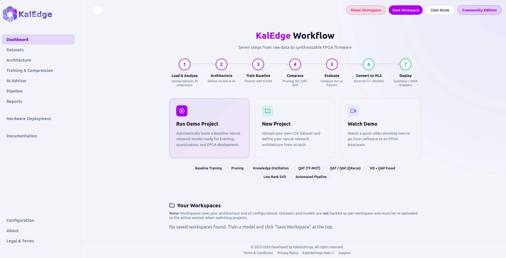

# KalEdge: AI Optimization and Deployment for FPGAs

KalEdge is a platform developed by KaleidoForge and designed to bridge the gap between Deep Learning model design and efficient hardware (FPGA) implementation. Powered by **hls4ml**, KalEdge adds layers of automation, AI assisted optimization, and hardware synthesis workflows to make Edge AI accessible to software engineers and hardware designers alike.

Official Cloud Platform: [kaledge.kaleidoforge.com](https://kaledge.kaleidoforge.com)  
Documentation Portal: [GitHub Repository](https://github.com/kaleidoforge/kaledge)

<p align="center">
  
</p>

## Key Capabilities

*   **Visual Architecture Builder & Model Import:** Design neural networks visually or import pre trained `.h5` and `.keras` models directly for hardware compression.
*   **AI Architect & AI Advisor:** Leverage session local LLM agents (under a Bring Your Own Key model supporting Anthropic, OpenAI, and Google Gemini) to design hardware ready architectures and evaluate board constraints.
*   **Comprehensive Compression Suite:**
    *   **Pruning & Quantization Aware Training (QAT):** Minimize weight density and bitwidths using TensorFlow Model Optimization Toolkit and QKeras.
    *   **Quantization Aware Pruning (QAP):** Jointly prune and quantize weights simultaneously to maximize silicon efficiency without accuracy degradation.
    *   **Knowledge Distillation (KD):** Compress complex teacher networks into lightweight student models optimized for silicon.
    *   **Low Rank Factorization (SVD):** Decompose dense layers to reduce parameter counts.
    *   **Automated Optimization Pipeline:** Execute multi stage compression sequences and rank candidate models by custom hardware scores with a single click.
*   **Hardware Deployment (hls4ml & FPGA Firmware):**
    *   **hls4ml Integration:** Convert models to synthesizable C++, validate bit accuracy with cycle accurate C++ simulation, and generate hardware wrappers for **AXI DMA (1D/2D)**, **AXI Stream FIFO & GPIO (MicroBlaze / Artix 7 / Cmod A7)**, and **X HEEP (RISC V)**.
    *   **FPGA Firmware Synthesis:** Connect KalEdge to your local Vivado / Vitis HLS or X HEEP environment via the lightweight `build_server.py` agent to automate IP synthesis and bitstream generation directly from the UI.

## Quick Start (Docker Community Edition)

Pull and run the official prebuilt Community Edition container locally (no account or external login required):

```bash
docker pull ghcr.io/kaleidoforge/kaledge-community:latest

docker run -d \
  --name kaledge_community \
  -p 8080:8080 \
  -v $(pwd)/kaledge_workspace:/app/kaledge_workspace \
  --add-host=host.docker.internal:host-gateway \
  ghcr.io/kaleidoforge/kaledge-community:latest
```

Once running, open your browser at:

```text
http://localhost:8080
```

## Getting Started Workflow

1.  **Launch the Platform:** Start the Docker container and open `http://localhost:8080` (or access the cloud platform at [kaledge.kaleidoforge.com](https://kaledge.kaleidoforge.com)).
2.  **Load Datasets:** Upload your data in `.csv` format (see [Dataset Format Guide](docs/dataset-format.md)) or load built in datasets (MNIST, CIFAR 10) in the **Datasets** tab.
3.  **Configure AI Assistants (Optional):** Open the **Configuration** tab to enter your API key (Anthropic, OpenAI, or Gemini) and unlock the **AI Architect** and **AI Advisor**.
4.  **Define Architecture:** Build your reference baseline, student, and quantized architectures visually (or import a pretrained `.h5` or `.keras` model) in the **Architecture** tab.
5.  **Train Baseline & Compress:** Train the baseline model first to establish your reference accuracy, and from there apply pruning, knowledge distillation, SVD, or quantization in **Training & Compression** (or run the full sequence in **Pipeline**).
6.  **Convert & Synthesize:** Open **Hardware Deployment** to convert your model with **hls4ml**, run C++ simulation, package your target bus wrapper (AXI DMA, AXI Stream FIFO & GPIO, or X HEEP), and optionally launch local synthesis in the **FPGA Firmware** tab.

## Directory Structure

```text
kaledge/
├── LICENSE                    # KalEdge Community License terms
├── README.md                  # Platform overview and Docker quick start
├── docs/                      # Technical manuals and guides
├── examples/                  # Example datasets and reference workflows
└── tools/                     # Utility scripts and local build helpers
```

## Licensing

The KalEdge Community Edition container and documentation in this repository are distributed under the **KalEdge Community License** (see [LICENSE](LICENSE)):

*   **Free for Evaluation, Academic & Research Use:** Access to the KalEdge Community Edition is granted free of charge for personal evaluation, academic teaching, and non commercial research.
*   **Proprietary Platform Scope:** KalEdge is proprietary software owned by KaleidoForge. Reverse engineering, decompilation, modification, resale, sublicensing, or commercial redistribution of the platform container is prohibited without a separate commercial agreement with KaleidoForge.
*   **Open Source Libraries & User Outputs:** The underlying machine learning and synthesis libraries invoked by the platform (such as **hls4ml**, **QKeras**, and **TensorFlow**) remain free and open source under their respective licenses. All models, C++ HLS code, wrappers, and FPGA bitstreams generated by users belong entirely to the user.

*© 2025 2026 KaleidoForge | Lightning Bridges for Fast AI*
